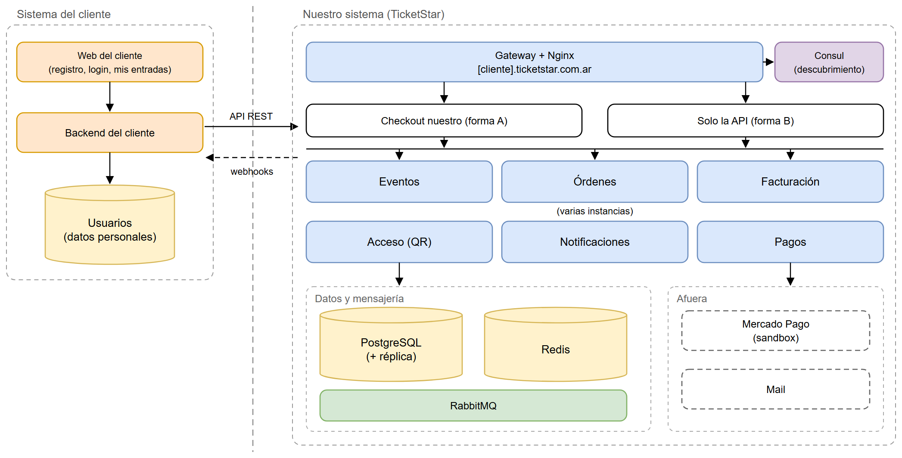

# Entrega 1: Propuesta de arquitectura

Tag: `v1-propuesta`

- [informe-entrega-1.pdf](informe-entrega-1.pdf): el informe, con el problema, por qué elegimos la temática y las cinco vistas del modelo 4+1. También está el [.docx](informe-entrega-1.docx).
- [presentacion-entrega-1.pdf](presentacion-entrega-1.pdf): la presentación. También está el [.pptx](presentacion-entrega-1.pptx).
- [infografia.png](infografia.png): la infografía del sistema.
- [diagramas/](diagramas): la vista lógica, la de procesos y la física.

