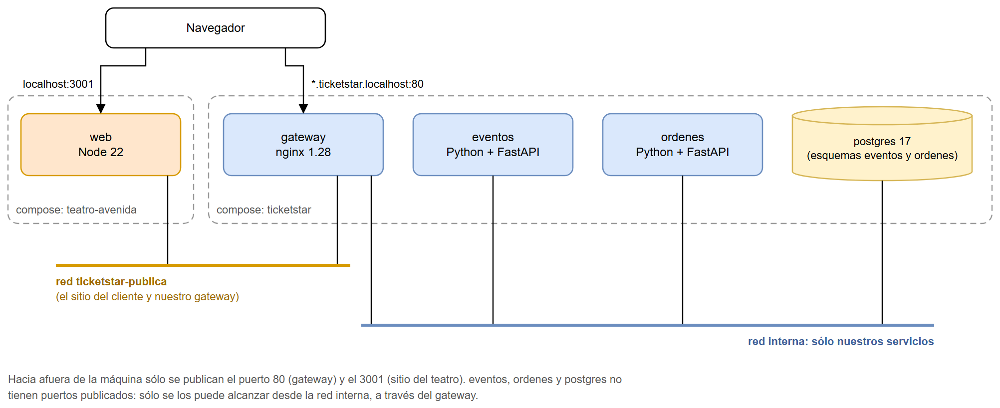

# Entrega 2: Infraestructura

Tag: `v2-infraestructura`

- [informe-entrega-2.pdf](informe-entrega-2.pdf): el informe descriptivo y técnico. También está el [.docx](informe-entrega-2.docx).
- [infraestructura.png](infraestructura.png): los dos compose, las dos redes y los puertos que se publican.
- [capturas/](capturas): el sitio del teatro, nuestro checkout y el sitio con el servicio de eventos apagado.

Para levantarlo, ver el [README de la raíz del repo](../../README.md).

