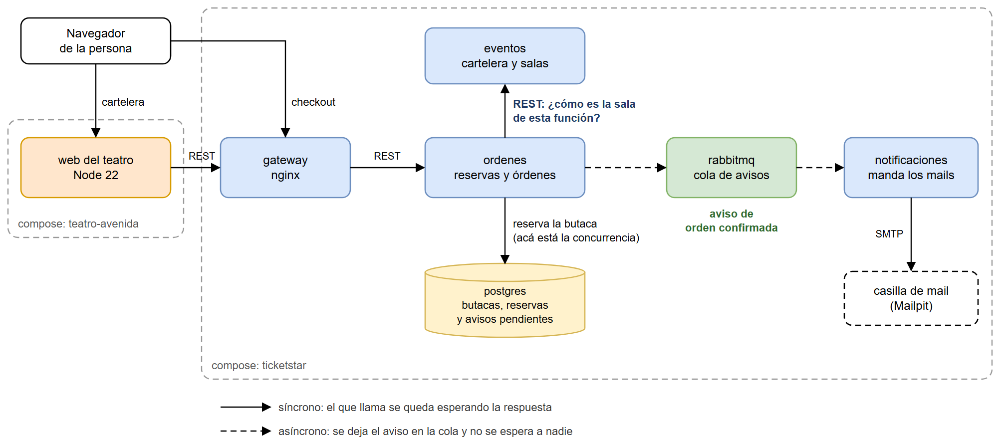
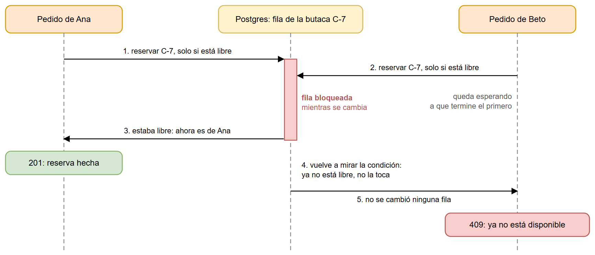

# Entrega 3: Comunicación síncrona y asíncrona

Tag: `v3-comunicacion`

- [informe-entrega-3.pdf](informe-entrega-3.pdf): el informe descriptivo y técnico. También está el [.docx](informe-entrega-3.docx).
- [comunicacion.png](comunicacion.png): cómo se hablan las partes, qué es síncrono y qué es asíncrono.
- [concurrencia.png](concurrencia.png): el caso de dos pedidos por la misma butaca, paso a paso.
- [capturas/](capturas): el checkout con el mapa de butacas, el aviso cuando otra persona se lleva la butaca, el mail de la compra, la cola de RabbitMQ con un aviso esperando y "Mis entradas" en el sitio del teatro.

Para reproducir el caso de concurrencia, con el sistema levantado y desde la raíz del repo:

```bash
python pruebas/concurrencia.py
```

Los pasos completos, y cómo ver el mismo script fallando sin el arreglo, están en [pruebas/README.md](../../pruebas/README.md). Para levantar el sistema, ver el [README de la raíz del repo](../../README.md).




